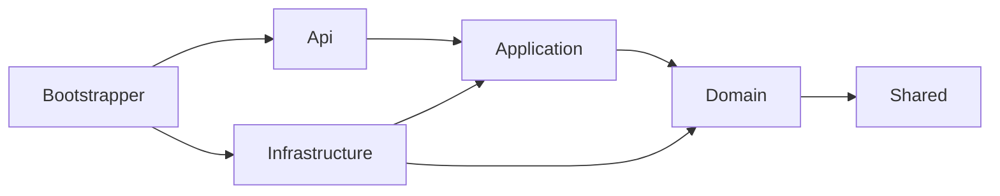
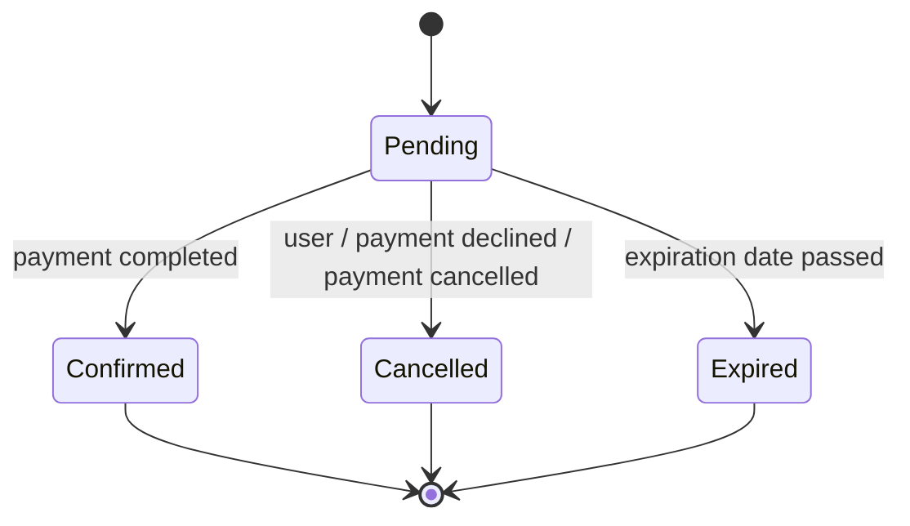
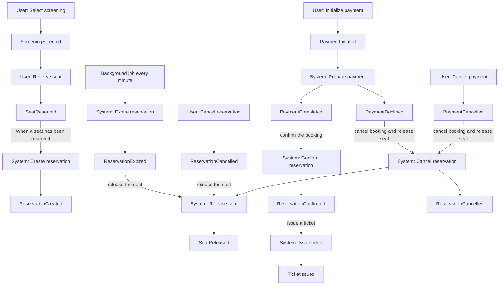

# ModularReservations

A learning project for **Domain-Driven Design**, **CQRS** and **message-based communication** in C# / .NET 10, built as a **modular monolith** around a cinema ticket reservation domain.

The domain was discovered with Event Storming. Board in Miro: [Board](https://miro.com/app/board/uXjVEQmpYLs=/?share_link_id=179729760873)

> **Status:** work in progress. The `Domain` layer of the `Reservations` module is implemented. Application, Infrastructure, API and the `Payments` / `Ticketing` modules are not implemented yet.

## Scope

The system covers the path from choosing a seat to a paid reservation and an issued ticket.

**In scope:** seat reservation, reservation lifecycle (pending, confirmed, cancelled, expired), payment, ticket issuing.

**Out of scope for now** (marked cyan on the board): movie catalog and screening scheduling, user registration, notifications (confirmation email), refunds, ticket scanning and ticket cancellation. Catalog and user data are expected to be seeded.

## Architecture

### Bounded contexts

| Module | Aggregates | Status |
|---|---|---|
| `Reservations` | `Screening` (with `Seat` entity), `Reservation` | Domain implemented |
| `Payments` | `Payment` | Planned |
| `Ticketing` | `Ticket` | Planned |

Each bounded context is a separate module. Modules communicate only through integration events, never by referencing each other.

### Solution structure

```
ModularReservations.slnx
└── src/
    ├── Bootstrapper/
    │   └── ModularReservations.Bootstrapper        ← ASP.NET Core host, single entry point
    ├── Modules/
    │   └── Reservations/
    │       ├── ModularReservations.Reservations.Domain
    │       ├── ModularReservations.Reservations.Application
    │       ├── ModularReservations.Reservations.Infrastructure
    │       └── ModularReservations.Reservations.Api
    └── Shared/
        └── ModularReservations.Shared              ← AggregateRoot, IEvent
```

Every layer of every module is a separate class library, so the compiler enforces layer boundaries. Only `Bootstrapper` is a Web API project.

### Layer dependencies



| Layer | Responsibility |
|---|---|
| **Domain** | Aggregates, entities, value objects, domain events, business rules. No framework dependencies. |
| **Application** | Command and query handlers, orchestration. Uses repository interfaces, never implementations. |
| **Infrastructure** | EF Core, repositories, message broker, external services, DI registration. |
| **Api** | Endpoints translating HTTP into commands and queries. No business logic. |
| **Shared** | Abstractions common to all modules. Contains no module-specific logic and references no module. |

## Domain model (Reservations module)

### `Screening` (aggregate root)

A single showing of a movie at a given time. Owns its seats and guards the main invariant: **a seat can be reserved only once per screening**.

- `Create(screeningDate, now, movieId, seatPositions)`: the date must be UTC and in the future, `movieId` must be set, and the seat positions must be non-empty and unique. The aggregate creates its own `Seat` entities, all free.
- `ReserveSeat(seatId, userId, reservationDate)`: rejected once the screening has started. Raises `SeatReservedEvent`.
- `ReleaseSeat(seatId)`: no time rule, because releasing a seat creates no obligation. Raises `SeatReleasedEvent`.

The movie is referenced only by `MovieId`.

### `Seat` (internal entity)

Identified by `Guid`, positioned by `SeatPosition`. Created and changed only through `Screening` (`internal` members). `Reserve()` rejects an already reserved seat and `Release()` rejects an already free one.

### `SeatPosition` (value object)

Row number and number in row, both greater than zero. Immutable record with value equality, used to detect duplicate positions.

### `Reservation` (aggregate root)

The lifecycle of a single seat reservation for a user. References the screening, seat and user by id.

- `Create(now, screeningId, reservationDate, seatId, userId)`: validates ids and the reservation date (UTC, not in the future). Starts as `Pending`, and the aggregate itself computes `ExpirationDate` (15 minutes after the reservation).
- `ConfirmReservation(now)`: only from `Pending`. Raises `ReservationConfirmedEvent`.
- `CancelReservation()`: only from `Pending`. Raises `ReservationCancelledEvent`.
- `ExpireReservation(now)`: only from `Pending`, after `ExpirationDate`. Raises `ReservationExpiredEvent`.



`Confirmed`, `Cancelled` and `Expired` are final states. `ReservationStatus` starts at `1`, so a default (`0`) value is never a valid status.

### Domain events

| Event | Raised by | Data |
|---|---|---|
| `SeatReservedEvent` | `Screening.ReserveSeat` | `ScreeningId`, `SeatId`, `UserId`, `ReservedAt` |
| `SeatReleasedEvent` | `Screening.ReleaseSeat` | `ScreeningId`, `SeatId` |
| `ReservationConfirmedEvent` | `Reservation.ConfirmReservation` | `ScreeningId`, `SeatId`, `ReservationId` |
| `ReservationCancelledEvent` | `Reservation.CancelReservation` | `ScreeningId`, `SeatId`, `ReservationId` |
| `ReservationExpiredEvent` | `Reservation.ExpireReservation` | `ScreeningId`, `SeatId`, `ReservationId` |

Aggregates inherit from `AggregateRoot` (in `Shared`), which collects events after a successful state change. Aggregates never publish events; the Application layer dispatches them after saving and then calls `ClearEvents()`.

### Design rules followed

- Aggregates are created only through static factory methods that validate every invariant. Constructors are private.
- State changes only through domain methods; setters are private.
- Aggregates reference each other only by id.
- The domain never reads the clock: the current time is passed in from outside.
- Event data comes from the aggregate's own state, not from the caller.
- One transaction changes one aggregate. Aggregates are coordinated by events (eventual consistency).

## Event Storming flows

Policies from the board that connect the aggregates:



Actors are `User` and `System`. The payment gateway is treated as part of `System`.

## Getting started

Requirements: [.NET 10 SDK](https://dotnet.microsoft.com/download).

```bash
dotnet build ModularReservations.slnx
dotnet run --project src/Bootstrapper/ModularReservations.Bootstrapper
```

The host currently has no module endpoints wired in.

## Roadmap

- [x] Event Storming (events, commands, actors, policies, aggregates)
- [x] Solution structure and layer references
- [x] `Reservations` domain: `Screening`, `Seat`, `SeatPosition`, `Reservation`, domain events
- [ ] Domain exceptions instead of `ArgumentException` / `InvalidOperationException`
- [ ] Unit tests for the domain
- [ ] `Reservations` Application layer: commands, queries, event handlers
- [ ] `Reservations` Infrastructure: EF Core, repositories, optimistic concurrency on aggregates
- [ ] Message broker and integration events between modules
- [ ] Background job expiring overdue reservations
- [ ] `Payments` module
- [ ] `Ticketing` module

### Open questions

- What happens when a payment completes after the reservation has already expired or been cancelled.
- Whether `ExpireReservation` and `ConfirmReservation` should throw or silently ignore calls on final states, consistently with `CancelReservation`.
- Where to validate `userId` and `reservationDate` so that a seat is never reserved without a matching reservation.
